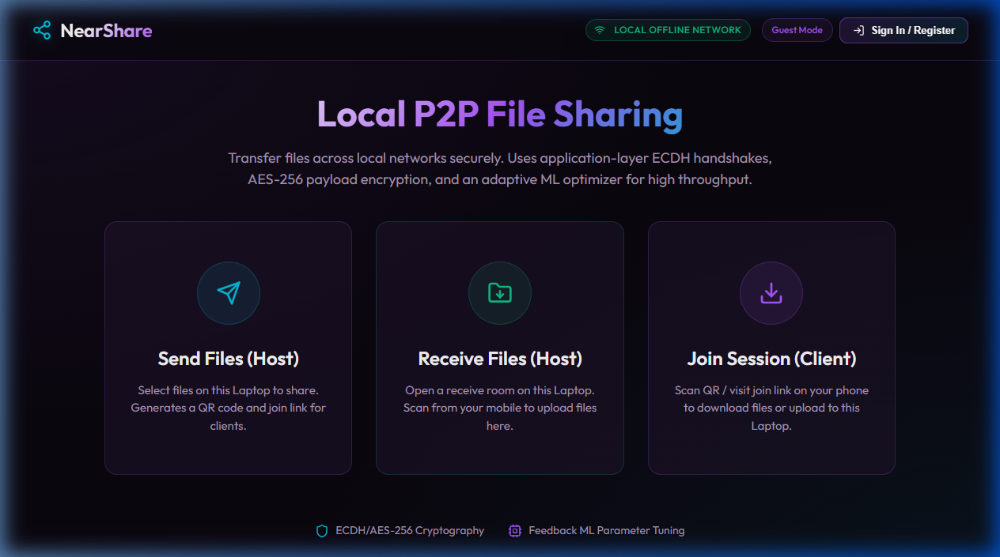
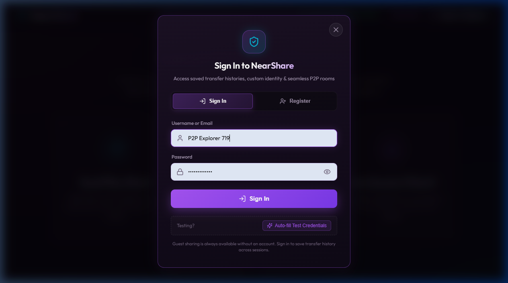
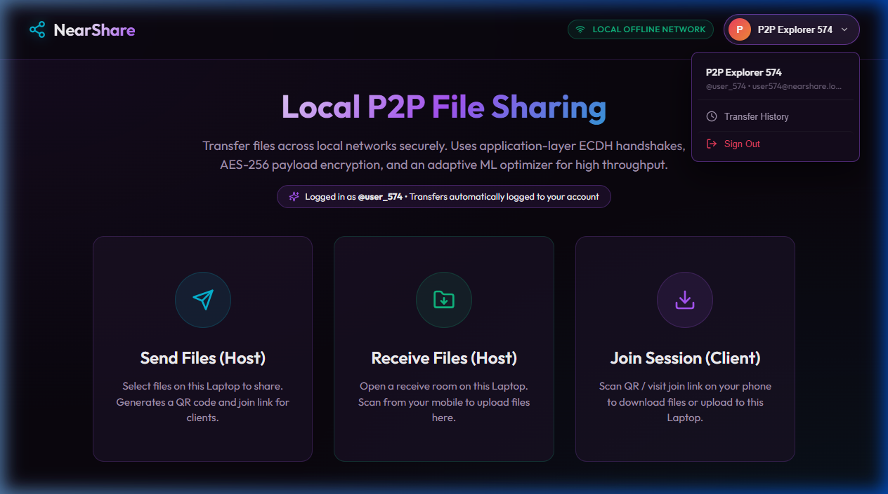
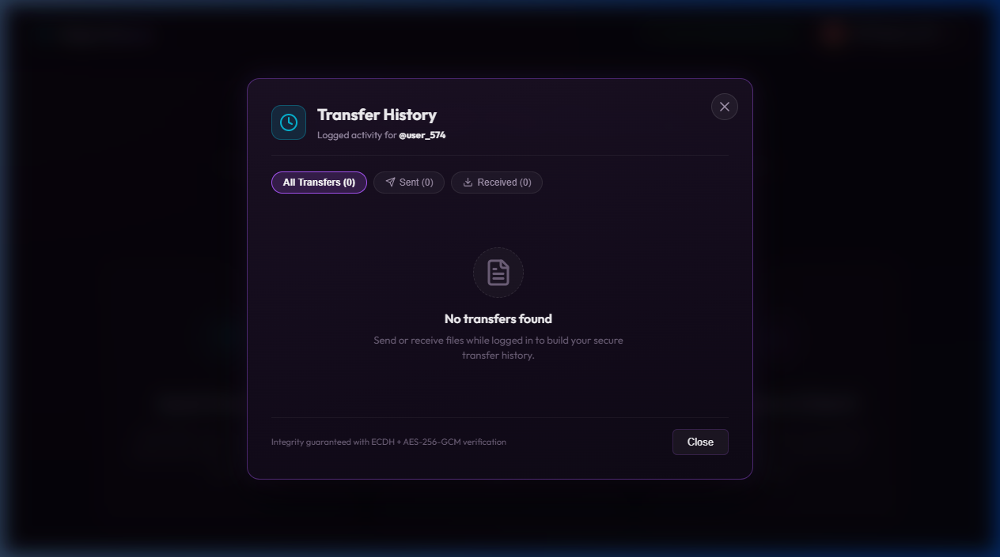
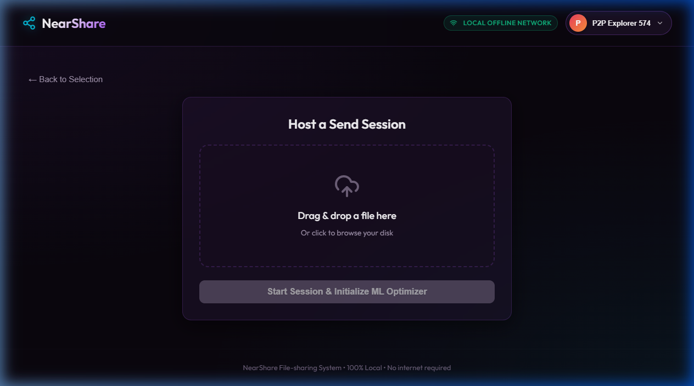
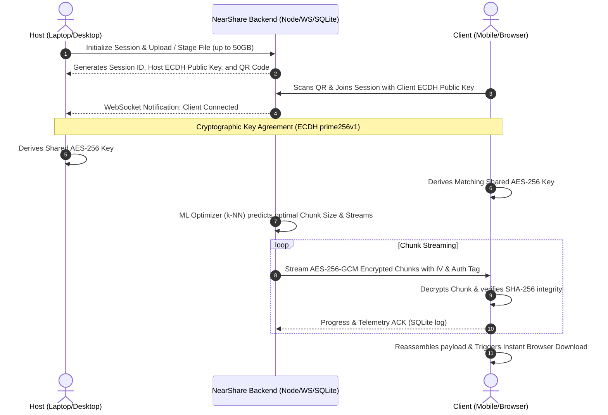

<div align="center">

  <h1>⚡ NearShare</h1>
  <p><strong>Ultra-Fast, Secure Local & Remote P2P File Sharing with E2E Encryption, User Authentication, and ML-Driven Transfer Optimization</strong></p>

  <p>
    <a href="https://github.com/PranjalSingh13/nearshare"></a>
    <a href="https://react.dev/"></a>
    <a href="https://nodejs.org/"></a>
    <a href="https://vitejs.dev/"></a>
    <a href="https://www.sqlite.org/"></a>
    <a href="https://en.wikipedia.org/wiki/Advanced_Encryption_Standard"></a>
  </p>

  <p>
    <b>100% Local &bull; Zero Cloud Dependency &bull; Up to 50 GB Payloads &bull; Instant QR Pairing &bull; User Accounts & Transfer History &bull; Guest Sharing Supported</b>
  </p>

</div>

---

## 📖 Overview

NearShare is a high-performance, browser-based peer-to-peer file transfer system engineered for seamless, lightning-fast file exchanges across local area networks (LAN) or remote endpoints via secure tunneling.

Unlike traditional cloud-hosted file transfer tools that route sensitive files through external servers, NearShare initiates an **application-layer cryptographic handshake** directly between host and peer. Files are dynamically split, encrypted with **AES-256-GCM**, piped over real-time **WebSockets**, and optimized on-the-fly using an embedded **k-Nearest Neighbors (k-NN) Machine Learning model** that monitors network telemetry to maximize throughput.

NearShare also features **User Accounts and Authentication** with personal transfer logs, while keeping **Guest Mode** fully accessible for zero-friction transfers.

---

## 🌟 Key Features

### 🛡️ 1. End-to-End Cryptography (Zero-Knowledge)
- **ECDH Key Agreement (`prime256v1`)**: Hosts and clients negotiate shared ephemeral secrets without passing raw encryption keys over the wire.
- **AES-256-GCM Authenticated Encryption**: Every chunk is encrypted with authenticated data tags and dedicated initialization vectors (IVs) to safeguard against man-in-the-middle (MitM) tampering.
- **SHA-256 Checksum Verification**: Every individual chunk and final reassembled file is validated with SHA-256 integrity digests to guarantee zero data corruption.

### 🧠 2. ML-Powered Adaptive Transfer Optimizer
- **k-NN Telemetry Model**: Learns from historical transfer session metrics (`file_size`, `num_clients`, `compression`, `chunk_size`, and `throughput_mbps`).
- **Dynamic Chunk Sizing**: Automatically tunes chunk payload size between **256 KB and 2 MB+** depending on file size and client count.
- **Content-Aware Compression Bypass**: Intelligently disables redundant gzip overhead on already-compressed formats (`.mp4`, `.zip`, `.png`, `.pdf`, `.mkv`, etc.) to save CPU cycles and reduce latency.

### 📱 3. Instant QR Code Peer Pairing
- **Dual Operating Modes**:
  - **Host Send**: Host shares files from desktop/laptop; generates a local QR code and join link for instant mobile downloading.
  - **Host Receive**: Host opens a receive drop-room; mobile devices scan the QR code to upload photos, videos, and documents directly to host storage.
- **Zero App Required**: Fully functional in any modern mobile or desktop web browser (Safari, Chrome, Firefox, Edge).

### 🚀 4. High-Capacity & Resumable Streaming
- **Up to 50 GB File Support**: Effortlessly handles heavy media files, raw 4K footage, operating system ISOs, and large database dumps.
- **SQLite State Persistence**: Tracks chunk delivery status (`saveChunkStatus`, `getClientProgress`), enabling dropped connections to resume from the last successful chunk instead of starting over.

### ⚡ 5. Real-Time Telemetry & WebSockets
- Full-duplex WebSocket streaming for instant progress updates, transfer speeds (MB/s), estimated time remaining (ETA), and live client connection status.

### 🔐 6. User Accounts, Authentication & Transfer History
- **Flexible Authentication**: Sign Up & Log In with Node's cryptographic `scrypt` password hashing with unique salts and HMAC-SHA256 signed JWT tokens.
- **Persistent Activity Tracking**: Automatically logs sent and received files, file sizes, timestamps, and room codes for registered users.
- **Frictionless Guest Sharing**: Retains instant zero-account peer-to-peer transfers without requiring mandatory registration.

---

## 📸 Application Showcase

### 1. Main Dashboard & Mode Selection (Guest Mode)
> Transfer files instantly across local networks. Guest mode is enabled by default with zero registration friction.

<div align="center">
  
</div>

---

### 2. User Authentication (Sign In & Registration)
> Modern glassmorphic authentication dialog supporting sign in, registration, scrypt password hashing, and one-click test credentials autofill.

<div align="center">
  
</div>

---

### 3. Authenticated Member Dashboard & Profile Dropdown
> Displays user avatar with custom gradient, display name, account status, and quick-access profile dropdown.

<div align="center">
  
</div>

---

### 4. Personal Transfer History & Activity Logs
> Complete transfer history with filtering (**All**, **Sent ⬆️**, **Received ⬇️**), formatted byte sizes, timestamps, and room codes.

<div align="center">
  
</div>

---

### 5. Host Send File Staging & Pairing
> Select files to initiate session, tune chunk parameters with the ML optimizer, and generate instant QR codes for mobile clients.

<div align="center">
  
</div>

---

## 🏗️ Architecture & Data Flow



---

## 📂 Project Structure

```
nearshare/
├── screenshots/               # Application UI showcase screenshots
│   ├── 01_dashboard.png
│   ├── 02_auth_modal.png
│   ├── 03_logged_in_dashboard.png
│   ├── 04_transfer_history.png
│   └── 05_host_send.png
│
├── backend/
│   ├── auth.js                # Password hashing (scrypt), JWT issuance & auth middlewares
│   ├── crypto.js              # ECDH keypair, AES-256-GCM cipher/decipher & SHA-256
│   ├── db.js                  # SQLite3 schema (users, user_transfers, sessions, telemetry)
│   ├── ml_optimizer.js        # k-NN transfer parameter predictor & heuristics
│   ├── server.js              # Express REST API, WebSockets & Multer disk storage
│   ├── test_transfer.js       # Automated integration transfer test suite
│   ├── test_auth.js           # Password hashing & JWT unit tests
│   ├── test_api_auth.js       # End-to-end API authentication tests
│   └── package.json           # Backend dependencies (Express, ws, SQLite3, Multer)
│
├── frontend/
│   ├── src/
│   │   ├── components/
│   │   │   ├── AuthModal.jsx            # Sign In / Register dialog with validations
│   │   │   ├── TransferHistoryModal.jsx # Personal transfer activity & filter tabs
│   │   │   ├── HostDashboard.jsx        # QR generator, live metrics & drop zone
│   │   │   └── ClientView.jsx           # Mobile/browser client decryption & download
│   │   ├── App.jsx                      # Navigation, auth state & mode routing
│   │   ├── App.css                      # Modern dark-mode cyberpunk design system
│   │   └── main.jsx                     # React 19 bootstrap entry
│   ├── index.html
│   ├── vite.config.js                   # Vite server & LAN host binding (0.0.0.0)
│   └── package.json                     # Frontend dependencies (React 19, Lucide, QRCode)
│
├── package.json               # Workspace root scripts (concurrently runner)
├── package-lock.json
└── README.md
```

---

## 🛠️ Tech Stack

| Domain | Technology / Library | Role |
| :--- | :--- | :--- |
| **Frontend** | React 19, Vite 5.4 | High-performance reactive UI |
| **Icons & QR** | Lucide React, `qrcode` | Visual indicators & instant peer pairing |
| **Backend** | Node.js (ES Modules), Express | REST endpoints & static asset serving |
| **Authentication** | Node `crypto` (scrypt), HMAC-SHA256 | Secure password hashing & JWT token issuance |
| **Realtime** | `ws` (WebSockets) | Full-duplex state sync & chunk pipeline |
| **Storage & State** | SQLite3, Multer | User profiles, transfer logs & disk chunking |
| **Security** | Node `crypto` | ECDH (`prime256v1`), AES-256-GCM, SHA-256 |
| **Optimization**| Custom k-NN Engine, `zlib` | Network telemetry & dynamic compression |

---

## 🚀 Getting Started

### Prerequisites
- **Node.js**: v18.0.0 or higher
- **npm**: v9.0.0 or higher
- Connected to the **same Wi-Fi / Local Area Network** (or using the built-in tunnel option).

### 1. Installation
Clone the repository and install all dependencies in one command:

```bash
git clone https://github.com/PranjalSingh13/nearshare.git
cd nearshare
npm run setup
```

### 2. Run in Development Mode
Launch both the backend server and frontend Vite app simultaneously:

```bash
npm start
```

- **Frontend**: `http://localhost:5173` (or network IP e.g., `http://192.168.1.X:5173`)
- **Backend API & WebSockets**: `http://localhost:3000`

### 3. Remote Tunneling (Share Across the Internet)
To share files with peers outside your local Wi-Fi, run the built-in tunnel:

```bash
npm run tunnel
```

### 4. Production Build & Run
To compile the optimized production frontend and serve it directly via Express:

```bash
npm run prod
```

---

## 🔒 Security Specifications

- **Forward Secrecy**: Ephemeral ECDH key pairs ensure that past sessions cannot be decrypted even if host keys are inspected later.
- **Authenticated Encryption**: AES-256-GCM safeguards against bit-flipping and payload truncation attacks.
- **Secure Password Storage**: Passwords are salted with random 16-byte entropy and hashed via `scrypt` with constant-time equality checks.
- **Zero Cloud Storage**: Files reside strictly in memory/local disk staging on the host machine and are purged when sessions end.

---

## 👨‍💻 Author

**Pranjal Singh**
- GitHub: [@PranjalSingh13](https://github.com/PranjalSingh13)
- LinkedIn: [Pranjal Singh](https://www.linkedin.com/in/pranjal-singh-dev)
- LeetCode: [Pranjasinghl13](https://leetcode.com/u/Pranjasinghl13/)
- Email: [ppranjalsingh13@gmail.com](mailto:ppranjalsingh13@gmail.com)

---

## 📄 License

This project is licensed under the [MIT License](LICENSE).
